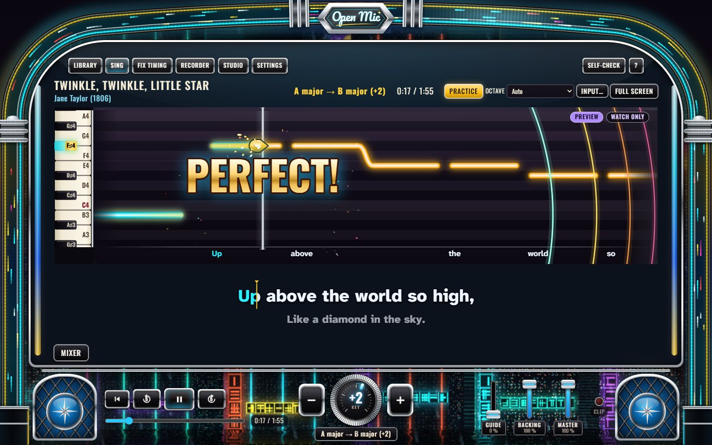
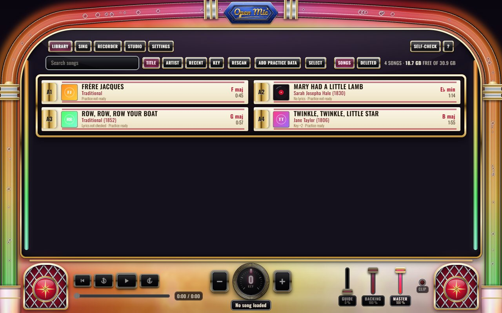
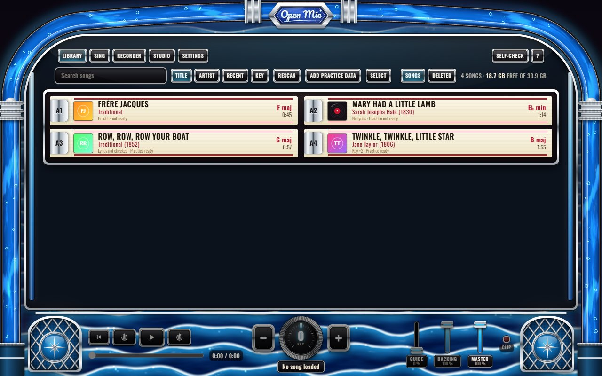
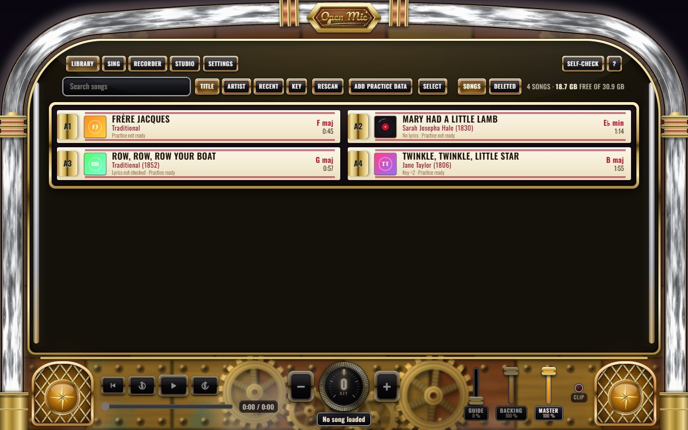
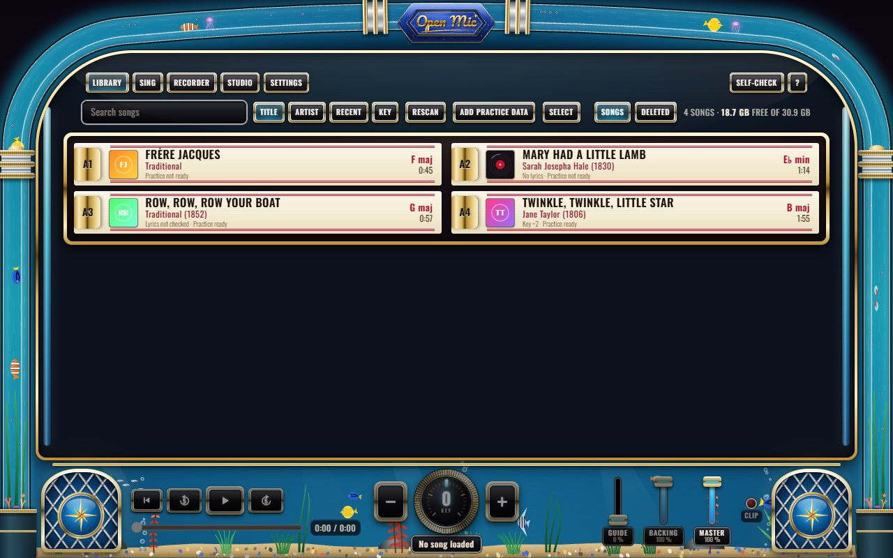
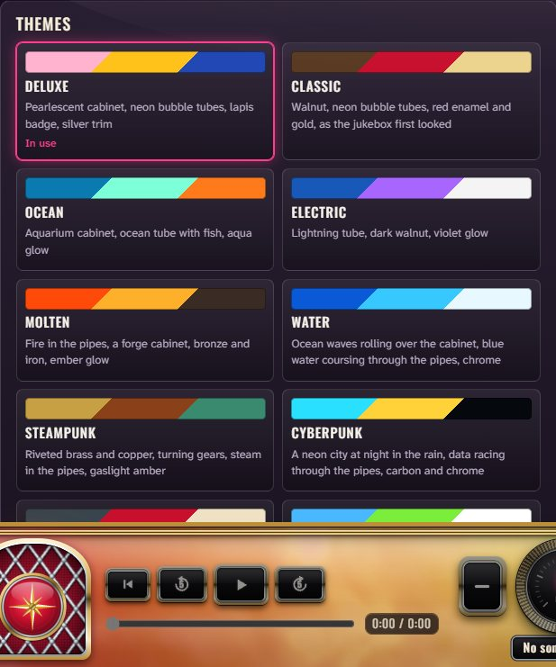

# Open Mic

Karaoke from any song, on a bubbler jukebox.


Open Mic is a free desktop karaoke app for Windows (macOS is written but not yet built,
see [Status](#status)). On a Windows PC with an NVIDIA graphics card it takes a song you
own (an audio or video file), takes the lead singer out while keeping the rest of the
recording (backing vocals and harmonies included), and lines the lyrics up with the singing
down to the letter. The result is one song file (`.jksong`) that plays on any ordinary PC
with the same sound.

While you sing, each line of the lyrics stands still on screen and a gold colour wipe runs
through it word by word as it is sung, a slim progress bar riding its edge, with the next
line underneath (or, if you prefer, the lyrics slide from right to left under a fixed
marker). You can move the song into your key, up or down by up to 12 semitones, without
changing its speed, and the drums are left alone so they do not sound processed. The app
also has a recorder that captures what the computer plays, losslessly. Everything, the app
and your songs, can live on one USB stick and runs without installing anything.

**Practice mode** shows the song's melody as glowing bars on a note lane with piano keys
down the side, puts a marker at the pitch you sing, and grades the take at the end, line by
line. It follows the key you choose and counts the right note sung an octave lower or
higher as right. It listens to your microphone or mixer only while the practice screen is
open and never records your voice. Every song carries the melody it needs, worked out from
its lead vocal without a model. It is new: it has been measured with generated and recorded
voices ([`docs/benchmarks/practice.md`](docs/benchmarks/practice.md)), and feedback from
real singers is welcome. Without a microphone, **Watch only** shows a preview in which a
perfect voice follows the melody.



## Download

From the [latest release](https://github.com/benrivera8765/open-mic/releases/latest), for
Windows 10 and 11:

1. **Open-Mic-part1.zip** is the app, with a demo song. Unzip it (right-click > Extract
   All) and double-click `Open Mic\Windows\Open Mic.exe`.
2. **Open-Mic-part2.zip** adds what the Studio needs to make your own songs (an NVIDIA
   graphics card with about 6 GB of memory or more). Unzip it into the same folder as part
   1: in Extract All, change "part2" at the end of the folder to "part1". Then open
   **Studio** in the app and press **Download models** once (about 3.8 GB).

GitHub limits each file to 2 GB, so the Studio's graphics-card libraries come as part 2.

## Themes

The whole cabinet is themable: Settings > Themes has ten looks, each a preset of the
cabinet, the tubes round the screen, the metals, the badge, the glow colour, the note
colours and the effects. Every part can then be changed on its own; clicking the theme in
use again puts it back.

| | |
|---|---|
|  |  |
|  |  |

Deluxe, Classic, Ocean (an aquarium with fish), Electric (a lightning tube), Molten (fire
and flowing lava), Water, Steampunk and Cyberpunk (a neon city in the rain). On Windows
the animated cabinets and pipes are drawn on the graphics card (WebGL; Settings > Customize the jukebox > "GPU lava and fire"), and Settings > Look >
"Frame rate" lets them run up to 240 fps on a fast screen. Elsewhere, or with that switched
off, lighter 2D versions are shown.



More screenshots and where they come from: [docs/screenshots/](docs/screenshots/README.md).

## Status

Read this first.

- **Windows**: the app and the Studio are built and tested on one Windows 11 PC (RTX 5070
  Ti). The app is not code-signed, so Windows SmartScreen warns the first time (see
  [Windows](#windows)).
- **Mac**: **not built or run on a Mac yet.** Its code compiles for Apple Silicon
  (type-checked from Windows), and the build script and CI workflow are written, but they
  have not run. Everything below about the Mac describes how it is designed to work
  ([`docs/MAC.md`](docs/MAC.md)).
- **Practice mode** is new and has been measured with generated and recorded voices, not
  yet with many real singers.
- The GPU effects of the themes are tested on an NVIDIA card (and in a software renderer);
  other graphics cards fall back to the 2D versions if anything goes wrong.

The measured results are in [`docs/benchmarks/`](docs/benchmarks/). Open Mic was developed
under the working name **Jukeoke**: you will still see it in internal names (the Rust
crates, the `jukeoke-cli` tool, the Python package, the `.jksong` format and the bundle id
`org.jukeoke.app`) and in older documents.

## Running it from a USB stick

Format the stick as **exFAT** (both Windows and macOS can read and write it). The stick
holds:

```
Windows/      Open Mic.exe, resources/ (the demo song) and Studio/ (the song maker)
Mac/          Open Mic.app (and Tools/sck_probe, a recorder check)
Library/      your songs (.jksong); subfolders are fine
Recordings/   what the recorder captured
Exports/      backing tracks you exported
Models/       the Studio's model weights (Windows only)
Settings/     settings, logs and self-check reports
```

Everything the app writes stays on the stick; it does not depend on the drive letter, and
the same folder also works copied to an internal drive (faster for the Studio). The
library shows how much space is left. With the Studio and its default models the stick
needs about 9 GB, leaving room for roughly 130 to 250 songs on a 32 GB stick (80 to 150 MB
each).

### Windows

Double-click `Windows\Open Mic.exe`. Windows 11 needs nothing installed (the app uses the
Edge WebView2 that comes with Windows). The app is not code-signed: if Windows shows
"Windows protected your PC", choose **More info**, then **Run anyway**.

The recorder captures the system mix after Windows' own processing, so sound-driver
effects such as "Audio enhancements" end up in the recording: for an exact copy, turn them
off for the output device (*Settings > System > Sound >* your speakers or headphones).

On Windows the Recorder can also work with your music player (any app in Windows' media
controls). **Record & play** starts the recording and then presses play in the player, so
the start of the song is never missed. **Record songs separately** keeps recording while the
player goes from song to song and then cuts the recording into one file per song, named
after what the player shows, with its cover (`Recordings/<date time>/`); advertisements go
to an `_excluded` folder, and "Make karaoke songs from all complete songs" sends the songs
to the Studio. The player's and Windows' volume are in the recording, so set them before
you start; switch off the player's crossfade or automix for clean cuts. Many streaming
services' terms do not allow recording their streams: record only what you may, for your
own use.

### Mac (macOS 13 Ventura or later, Apple Silicon)

Open `Mac/Open Mic.app` from the stick.

- **A copy that came over on the stick from Windows opens with a plain double-click.**
- **A copy downloaded from the internet** is blocked the first time, because the app is not
  notarised by Apple (no paid developer account). Do this once: in **Finder** (not
  Launchpad), **Control-click** the app, choose **Open**, then click **Open** in the dialog.
  Expected wording: *"macOS cannot verify the developer of "Open Mic". Are you sure you want
  to open it?"* After that it opens normally. Alternative: *System Settings > Privacy &
  Security*, scroll down, **Open Anyway**. If the app then asks where your songs are,
  choose the stick (macOS ran it from a hidden copy; `docs/MAC.md` section 6 explains).
- **The recorder needs the "Screen Recording" permission.** macOS gives apps the
  computer's sound only through its screen-capture service, so the first time you record,
  macOS asks whether *"Open Mic" would like to record this computer's screen and audio*.
  Open Mic records sound only: it asks for the smallest possible picture (2 x 2 pixels, once
  a second) and throws it away unseen. Allow it in *System Settings > Privacy & Security >
  Screen Recording*, then quit and reopen Open Mic. Because the app is signed ad hoc, macOS
  may ask again after each new version.
- For a recording with no sample-rate conversion, set the Mac's output to 48,000 Hz in
  *Audio MIDI Setup* (macOS converts other rates to 48 kHz before an app can record them).
  The format the recorder shows is exactly what ScreenCaptureKit (macOS's capture
  service) delivers.
- **Self-check** (button at the top right): plays a quiet test tone, renders and shifts the
  bundled demo song, makes a three-second test recording and writes a plain-text report into
  `Settings/` on the stick. Bring that report back if something does not work.

The Mac plays, changes key, edits lyric timing and records; it does not make songs.

## Making songs (Windows with an NVIDIA graphics card)

The Studio needs Windows, an NVIDIA graphics card with about 6 GB of memory or more, 12 GB
of RAM, and the `Windows/Studio` folder on the stick. On any other computer the app opens
and plays as usual and says why the Studio is unavailable.

1. Open **Studio** and, the first time, press **Download models** (about 3.8 GB with the
   lyrics models; nothing is downloaded until you press it).
2. Drop audio or video files on the window (mp3, m4a, flac, wav, ogg, opus, aiff, wma, mp4,
   mkv, mov, webm, avi), or choose them. Check the title, artist and album, and replace
   the cover picture with a JPEG or PNG, or remove it, if you like.
3. Choose where the lyrics come from: paste them, choose an `.lrc` file, use the lyrics
   inside the file, press **Look up lyrics online**, or let the Studio write down what is
   sung (marked "unchecked" until you correct it).
4. Leave the queue running. A four-minute song takes about three minutes on an RTX 5070 Ti.
   A bad file fails with a plain message and the queue goes on.
5. **Fix timing** corrects the lyrics afterwards: a global offset, nudging or dragging a
   line, tapping along, editing the text. Realigning corrected text needs the Studio; the
   manual tools work on the Mac too.

Audio stays lossless throughout: the stems are stored as 24-bit FLAC, nothing is
normalised or limited, and exports are FLAC or 32-bit float WAV.

### Quality presets

| preset | what it does | model licences | earning money with the result |
|---|---|---|---|
| **Full** (default) | subtracts the lead vocal from the original, so the band is not rebuilt (a little cymbal brightness can go with the voice); leaves less of the singer than Clean (measured lead residue -15.9 dB) | GPL-3.0 and Apache-2.0 | allowed by every model's licence |
| Clean | an instrumental model rebuilds the music: slightly more of the singer left (-14.8 dB), cymbals a little brighter, the stereo image sometimes wider than the recording | the instrumental model has no published licence | unclear: ask its author first |
| Permissive | only MIT / Apache-2.0 models; backing vocals are removed with the lead (no separate backing track) | MIT and Apache-2.0 | allowed |

Only the Full models are on a prepared stick. Choosing Clean or Permissive in the Studio
form shows which models are missing, their size and licence, and downloads them when you
press the button.

Every model, its source and its licence: [`MODELS.md`](MODELS.md). Model weights are
downloaded by the app, never included in the repository or the app.

## Privacy

No telemetry, no accounts, no ads. The app works fully offline. Practice mode analyses the microphone in memory
and never records, saves or sends it. It goes online only when
you ask it to: **Download models** (from Hugging Face and the model authors' release
pages) and **Look up lyrics online** (sends only the title, artist and length to LRCLIB).
Nothing is written outside the stick, apart from what Windows and macOS record about any
program and, on a Mac that ran a downloaded copy, one small file that remembers where the
stick is (`docs/ARCHITECTURE.md` section 8).

## Building

The project is a Rust workspace (audio engine, song format, recorder, the Tauri 2 app), a
Preact + TypeScript UI and a Python package (the Studio). Contracts every part builds
against: [`docs/SONG_FORMAT.md`](docs/SONG_FORMAT.md),
[`docs/STUDIO_PROTOCOL.md`](docs/STUDIO_PROTOCOL.md), [`docs/APP_API.md`](docs/APP_API.md);
the map is [`docs/ARCHITECTURE.md`](docs/ARCHITECTURE.md).

### Windows (GNU toolchain, no Visual Studio needed)

Needs Rust (stable, `x86_64-pc-windows-gnu`), WinLibs GCC, Node 24+, uv and Git Bash.
`scripts/devenv.sh` puts them on the PATH for one shell; adjust its paths to where your
tools live.

```bash
source scripts/devenv.sh                      # sets $JK_BUILD = ../jukeoke-build
export CARGO_TARGET_DIR="$JK_BUILD/target"
app/scripts/build-windows.sh                  # UI + release exe + DLL check -> $JK_BUILD/app-dist/Windows/
scripts/build-studio-runtime.sh <stick_root>  # relocatable Python + PyTorch runtime -> <stick_root>/Windows/Studio
scripts/check-studio-runtime.sh <stick_root>  # proves it runs from another drive letter
```

The Studio's development environment is described in [`studio/README.md`](studio/README.md)
and the runtime in [`docs/STUDIO_RUNTIME.md`](docs/STUDIO_RUNTIME.md).

### Mac (Apple Silicon, macOS 13 minimum)

On a Mac, in the project folder:

```sh
bash scripts/build-mac.sh      # installs Rust/Node for the user if missing, builds, signs ad hoc, checks minimum macOS
```

The result is `dist/Mac/Open Mic.app`. Or push the repository to GitHub: `.github/workflows/ci.yml`
builds and tests both platforms (including a launch from an exFAT disk image), and
`release.yml` builds both when started by hand. Neither has run yet; on a public repository
they run on GitHub's free runners.

## Repository map

```
app/src-tauri/   the app core (Rust, Tauri 2): commands, playback, library, recorder, Studio supervisor, self-check
app/ui/          the UI (Preact + TypeScript): screens, lyrics ticker, sync editor, jukebox skin
crates/          jk-format (song file), jk-engine (player), jk-dsp (mix + key change), jk-rubberband
                 (vendored Rubber Band), jk-recorder (system audio capture), jk-cli (developer tool)
studio/          the Studio (Python): decode, separate, lyrics, align, key and tempo, write .jksong
docs/            specifications, architecture, Mac notes, benchmarks, screenshots
scripts/         build, CI, licence and dev-environment scripts
tests/           cross-language song-file conformance tests and generated fixtures
branding.json    the app name and identifiers (the only place to rename it)
```

Contributing: [`CONTRIBUTING.md`](CONTRIBUTING.md). Decisions and their reasons:
[`DECISIONS.md`](DECISIONS.md).

## Licence

Open Mic is free software under the **GNU General Public License, version 3 or (at your
option) any later version** ([`LICENSE`](LICENSE)). It uses the Rubber Band Library
(GPL-2.0-or-later) for key changes. Third-party components and their licences:
[`THIRD_PARTY_LICENSES.md`](THIRD_PARTY_LICENSES.md) (generated by
`scripts/gen-third-party.sh`); models: [`MODELS.md`](MODELS.md). The fonts are under the
SIL Open Font License 1.1. The jukebox look is drawn in code and is not the design of any
manufacturer.
