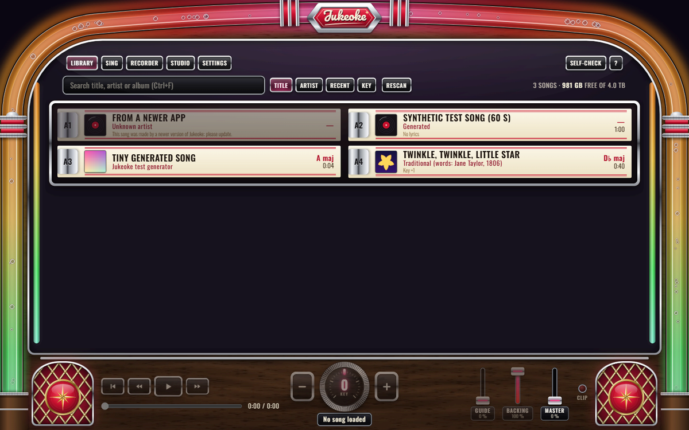
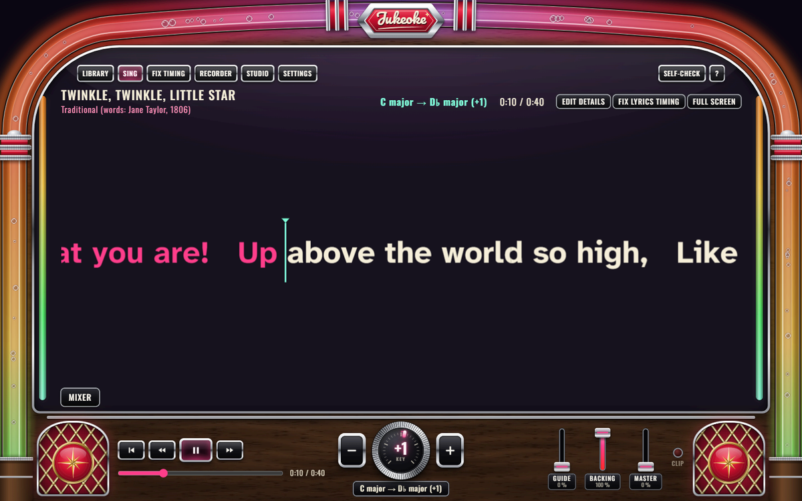
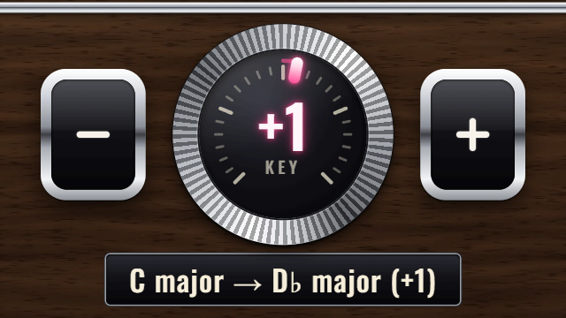
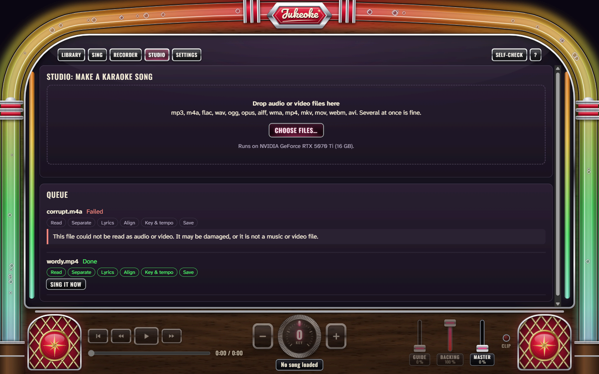
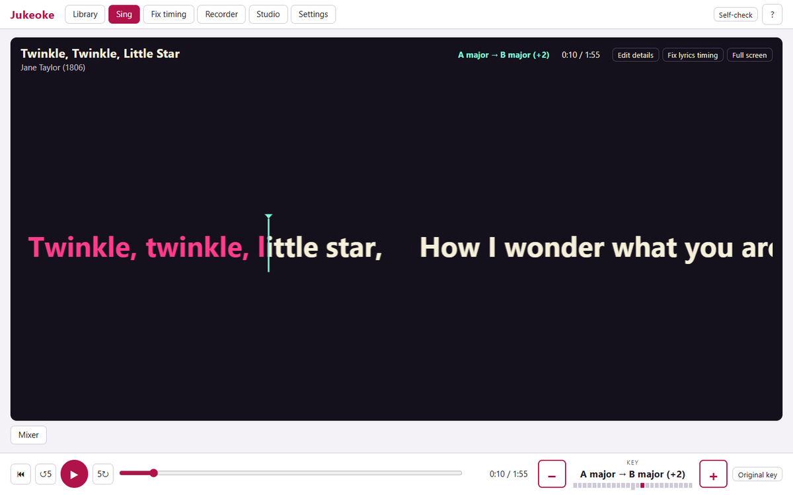

# Jukeoke

Karaoke from any song, on a bubbler jukebox.

Jukeoke is a free desktop karaoke app for Windows and macOS. On a Windows PC with an NVIDIA
graphics card it takes a song you own (an audio or video file), takes the lead singer out
while keeping the rest of the recording (backing vocals and harmonies included), and lines
the lyrics up with the singing down to the letter. The result is one song file
(`.jksong`) that plays on any ordinary Windows PC or Mac with the same sound.

While you sing, the lyrics slide from right to left under a fixed marker that sits on the
exact letter being sung. You can move the song into your key, up or down by up to 12
semitones, without changing its speed, and the drums are left alone so they do not sound
processed. The app also has a recorder that captures whatever the computer is playing,
losslessly. Everything, both apps and your songs, can live on one USB stick and runs
without installing anything.

"Jukeoke" is a placeholder name.



| | |
|---|---|
|  |  |
|  |  |

More screenshots and where they come from: [docs/screenshots/](docs/screenshots/README.md).

## Status

Read this first. The Windows app and the Studio are built and tested on one Windows 11 PC
(RTX 5070 Ti). **The Mac app has not been built or run on a Mac yet**: its code compiles
for Apple Silicon (type-checked from Windows), and the build script and CI workflow are
written, but there has been no GitHub runner and no Mac to run them on. Everything below
about the Mac describes how it is designed to work. The measured results are in
[`docs/benchmarks/`](docs/benchmarks/) and the Mac details in [`docs/MAC.md`](docs/MAC.md).

## Running it from a USB stick

Format the stick as **exFAT** (both Windows and macOS can read and write it). The stick
holds:

```
Windows/      Jukeoke.exe, resources/ (the demo song) and Studio/ (the song maker)
Mac/          Jukeoke.app (and Tools/sck_probe, a recorder check)
Library/      your songs (.jksong); subfolders are fine
Recordings/   what the recorder captured
Exports/      backing tracks you exported
Models/       the Studio's model weights (Windows only)
Settings/     settings, logs and self-check reports
```

Everything the app writes stays on the stick; it does not depend on the drive letter, and
the same folder also works copied to an internal drive (faster for the Studio). The
library shows how much space is left. With the Studio and its default models the stick
needs about 9 GB, leaving room for roughly 130 to 250 songs on a 32 GB stick (80 to 150 MB
each).

### Windows

Double-click `Windows\Jukeoke.exe`. Windows 11 needs nothing installed (the app uses the
Edge WebView2 that comes with Windows). The app is not code-signed: if Windows shows
"Windows protected your PC", choose **More info**, then **Run anyway**.

### Mac (macOS 13 Ventura or later, Apple Silicon)

Open `Mac/Jukeoke.app` from the stick.

- **A copy that came over on the stick from Windows opens with a plain double-click.**
- **A copy downloaded from the internet** is blocked the first time, because the app is not
  notarised by Apple (no paid developer account). Do this once: in **Finder** (not
  Launchpad), **Control-click** the app, choose **Open**, then click **Open** in the dialog.
  Expected wording: *"macOS cannot verify the developer of "Jukeoke". Are you sure you want
  to open it?"* After that it opens normally. Alternative: *System Settings > Privacy &
  Security*, scroll down, **Open Anyway**. If the app then asks where your songs are,
  choose the stick (macOS ran it from a hidden copy; `docs/MAC.md` section 6 explains).
- **The recorder needs the "Screen Recording" permission.** macOS gives apps the
  computer's sound only through its screen-capture service, so the first time you record,
  macOS asks whether *"Jukeoke" would like to record this computer's screen and audio*.
  Jukeoke records sound only: it asks for the smallest possible picture (2 x 2 pixels, once
  a second) and throws it away unseen. Allow it in *System Settings > Privacy & Security >
  Screen Recording*, then quit and reopen Jukeoke. Because the app is signed ad hoc, macOS
  may ask again after each new version.
- For a recording with no sample-rate conversion, set the Mac's output to 48,000 Hz in
  *Audio MIDI Setup* (macOS converts other rates to 48 kHz before an app can record them).
  The recorder always shows the format you are getting.
- **Self-check** (button at the top right): plays a quiet test tone, renders and shifts the
  bundled demo song, makes a three-second test recording and writes a plain-text report into
  `Settings/` on the stick. Bring that report back if something does not work.

The Mac plays, changes key, edits lyric timing and records; it does not make songs.

## Making songs (Windows with an NVIDIA graphics card)

The Studio needs Windows, an NVIDIA graphics card with about 6 GB of memory or more, 12 GB
of RAM, and the `Windows/Studio` folder on the stick. On any other computer the app opens
and plays as usual and says why the Studio is unavailable.

1. Open **Studio** and, the first time, press **Download models** (about 3.8 GB with the
   lyrics models; nothing is downloaded until you press it).
2. Drop audio or video files on the window (mp3, m4a, flac, wav, ogg, opus, aiff, wma, mp4,
   mkv, mov, webm, avi), or choose them. Check the title and artist.
3. Choose where the lyrics come from: paste them, choose an `.lrc` file, use the lyrics
   inside the file, press **Look up lyrics online**, or let the Studio write down what is
   sung (marked "unchecked" until you correct it).
4. Leave the queue running. A four-minute song takes about three minutes on an RTX 5070 Ti.
   A bad file fails with a plain message and the queue goes on.
5. **Fix timing** corrects the lyrics afterwards: a global offset, nudging or dragging a
   line, tapping along, editing the text. Realigning corrected text needs the Studio; the
   manual tools work on the Mac too.

Audio stays lossless throughout: the stems are stored as 24-bit FLAC, nothing is
normalised or limited, and exports are FLAC or 32-bit float WAV.

### Quality presets

| preset | what it does | model licences | earning money with the result |
|---|---|---|---|
| **Full** (default) | subtracts the lead vocal from the original: nothing else is lost | GPL-3.0 and Apache-2.0 | allowed by every model's licence |
| Clean | an instrumental model: less vocal residue, sometimes less body | the instrumental model has no published licence | unclear: ask its author first |
| Permissive | only MIT / Apache-2.0 models; backing vocals stay with the lead (no separate backing track) | MIT and Apache-2.0 | allowed |

Every model, its source and its licence: [`MODELS.md`](MODELS.md). Model weights are
downloaded by the app, never included in the repository or the app.

## Privacy

No telemetry, no accounts, no ads. The app works fully offline. It goes online only when
you ask it to: **Download models** (from Hugging Face and the model authors' release
pages) and **Look up lyrics online** (sends only the title, artist and length to LRCLIB).
Nothing is written outside the stick, apart from what Windows and macOS record about any
program and, on a Mac that ran a downloaded copy, one small file that remembers where the
stick is (`docs/ARCHITECTURE.md` section 8).

## Building

The project is a Rust workspace (audio engine, song format, recorder, the Tauri 2 app), a
Preact + TypeScript UI and a Python package (the Studio). Contracts every part builds
against: [`docs/SONG_FORMAT.md`](docs/SONG_FORMAT.md),
[`docs/STUDIO_PROTOCOL.md`](docs/STUDIO_PROTOCOL.md), [`docs/APP_API.md`](docs/APP_API.md);
the map is [`docs/ARCHITECTURE.md`](docs/ARCHITECTURE.md).

### Windows (GNU toolchain, no Visual Studio needed)

Needs Rust (stable, `x86_64-pc-windows-gnu`), WinLibs GCC, Node 24+, uv and Git Bash.
`scripts/devenv.sh` puts them on the PATH for one shell; adjust its paths to where your
tools live.

```bash
source scripts/devenv.sh                      # sets $JK_BUILD = ../jukeoke-build
export CARGO_TARGET_DIR="$JK_BUILD/target"
app/scripts/build-windows.sh                  # UI + release exe + DLL check -> $JK_BUILD/app-dist/Windows/
scripts/build-studio-runtime.sh <stick_root>  # relocatable Python + PyTorch runtime -> <stick_root>/Windows/Studio
scripts/check-studio-runtime.sh <stick_root>  # proves it runs from another drive letter
```

The Studio's development environment is described in [`studio/README.md`](studio/README.md)
and the runtime in [`docs/STUDIO_RUNTIME.md`](docs/STUDIO_RUNTIME.md).

### Mac (Apple Silicon, macOS 13 minimum)

On a Mac, in the project folder:

```sh
bash scripts/build-mac.sh      # installs Rust/Node for the user if missing, builds, signs ad hoc, checks minimum macOS
```

The result is `dist/Mac/Jukeoke.app`. Or push the repository to GitHub: `.github/workflows/ci.yml`
builds and tests both platforms (including a launch from an exFAT disk image), and
`release.yml` builds both when started by hand. Neither has run yet.

## Repository map

```
app/src-tauri/   the app core (Rust, Tauri 2): commands, playback, library, recorder, Studio supervisor, self-check
app/ui/          the UI (Preact + TypeScript): screens, lyrics ticker, sync editor, jukebox skin
crates/          jk-format (song file), jk-engine (player), jk-dsp (mix + key change), jk-rubberband
                 (vendored Rubber Band), jk-recorder (system audio capture), jk-cli (developer tool)
studio/          the Studio (Python): decode, separate, lyrics, align, key and tempo, write .jksong
docs/            specifications, architecture, Mac notes, benchmarks, screenshots
scripts/         build, CI, licence and dev-environment scripts
tests/           cross-language song-file conformance tests and generated fixtures
branding.json    the app name and identifiers (the only place to rename it)
```

Contributing: [`CONTRIBUTING.md`](CONTRIBUTING.md). Decisions and their reasons:
[`DECISIONS.md`](DECISIONS.md).

## Licence

Jukeoke is free software under the **GNU General Public License, version 3 or (at your
option) any later version** ([`LICENSE`](LICENSE)). It uses the Rubber Band Library
(GPL-2.0-or-later) for key changes. Third-party components and their licences:
[`THIRD_PARTY_LICENSES.md`](THIRD_PARTY_LICENSES.md) (generated by
`scripts/gen-third-party.sh`); models: [`MODELS.md`](MODELS.md). The fonts are under the
SIL Open Font License 1.1. The jukebox look is drawn in code and is not the design of any
manufacturer.
